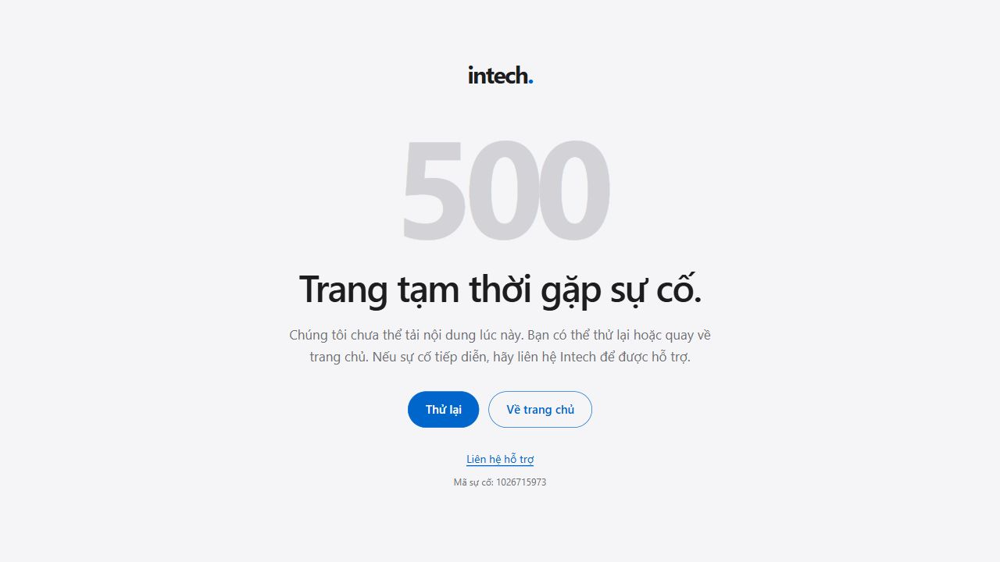
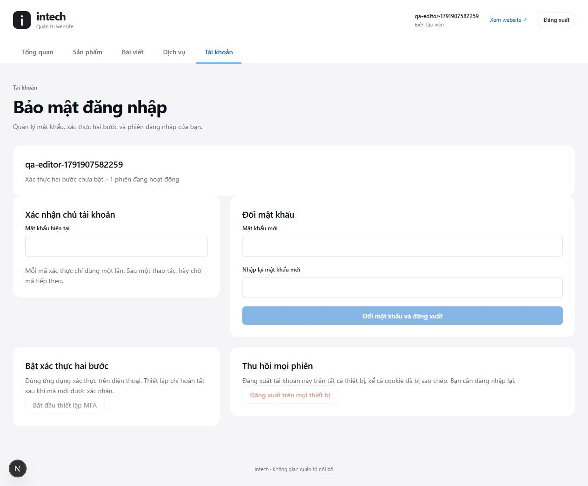

> Tài liệu lưu từ giai đoạn PostgreSQL, không phải hướng dẫn triển khai MySQL hiện tại. Xem [cPanel + MariaDB](../../CPANEL-MYSQL.md). Các kết quả database/restore cũ không chứng minh MariaDB iNET đã được kiểm tra.

# Chức năng được hoàn thiện — cập nhật 14/10/2026

Các chức năng thiếu ở lần rà soát trước đã hoàn thiện. Giao diện sản phẩm
giữ nguyên, không thêm chọn layout/vị trí chữ. DB là thử nghiệm đã được người
dùng xác nhận; dữ liệu gốc giữ nguyên, fixture được dọn.

| Chức năng | Kết quả |
| --- | --- |
| Dịch vụ CMS → public | Sửa/nháp/xuất bản/xóa, danh sách, chi tiết, metadata và sitemap đọc DB. Hạng mục/lợi ích theo mẫu cố định. |
| Đăng xuất | Session server lưu hash; cookie sao chép bị từ chối ngay, phiên khác vẫn hoạt động. |
| Tài khoản | Đổi password, setup/thay MFA, xem số phiên, revoke-all; yêu cầu reauthentication và chống dùng lại mã. |
| Bàn giao/recovery | Gói account riêng không ghi đè; maintenance recovery về secret ban đầu và thu hồi mọi phiên. |
| 404/500 | 404 Intech; error/global-error có retry/noindex, không hiển thị chi tiết lỗi. Đã phục hồi cả lỗi trang/root layout thật. |
| Backup | Schema2 giữ credential mã hóa, session bắt đầu rỗng. Restore cũ/mới vào hai DB riêng; hash/sequence/constraint khớp, MFA giải mã được. |
| Vận hành | Preflight cấu hình, health có token, cleanup hết hạn và hướng dẫn ownership/rollback/restore. |

**100/100 test**, 0 fail/skip: [test-final.log](test-final.log). TypeScript và
build sạch **550/550 trang** đã đạt. Số trang static giảm vì dịch vụ dùng
dynamic để cập nhật CMS có hiệu lực ngay. Runtime audit ngày13/10 có0 advisory; không coi
kết quả package audit là chứng nhận cloud.

Một lần build sau cleanup bị lỗi `fetch failed` khi kết nối Neon để prerender
hai trang catalog. Chạy lại cùng source đã đạt550/550, không bỏ qua kiểm tra
hay thay dữ liệu. Giữ [log thất bại](build-network-failure.log) và
[log build cuối](build-final.log); cần theo dõi DB/ingress trên deployment thật.

HTTP DB thật đạt14 checks: [completed-functions-http.json](completed-functions-http.json),
gồm lưu nội dung tiếng Việt dài, body quá giới hạn và cập nhật/ẩn liên kết
dịch vụ trên báo giá/bài viết sau khi cache đã được tải.
Test có xác nhận quota429, rồi reset riêng bucket của fixture để tiếp tục MFA;
không đổi giới hạn ứng dụng. Backup cũ/mới: [restore-updated-verification.json](restore-updated-verification.json).
Archive schema2 kiểm thử có một service/credential giả để đối chiếu đủ trường;
chúng đã xóa khỏi nguồn và hai DB QA đã xóa. Archive bí mật giữ trong backups,
không dùng archive fixture làm nội dung bàn giao chủ.

Rà soát cuối đã bổ sung kiểm thử cạnh tranh cập nhật credential trên PostgreSQL
thật: thay đổi thành công chỉ thu hồi phiên của đúng account; yêu cầu dùng
revision cũ bị409 và giữ nguyên phiên mới. Fixture đã dọn, xem
[auth-cas-live.json](auth-cas-live.json). Audit ghi thành công sau DB mutation,
đếm phiên chỉ tính fingerprint còn hiệu lực; xoay secret ban đầu vô hiệu hóa
phiên kể cả account có password/MFA override trong DB. Health kiểm tra đủ9
bảng/cột critical và từng quyền DML cần thiết, không đọc dữ liệu khách hàng.

Bản production sạch cuối ngày14/10 đạt12 smoke checks sau cleanup:
[final-artifact-http.json](final-artifact-http.json). Public200, URL sai404,
health401/200 theo token, admin503 khi thiếu cấu hình production là hành vi
đóng quyền đã xác nhận. Lượt mở lại tab trình duyệt ngày14/10 bị browser policy
chặn vì giao thức của tab hiện tại không được phép; không tìm cách vượt policy.
Ảnh/kiểm thử trình duyệt dưới đây là bằng chứng của lượt QA trước đó.

500 production local: [error-recovery-browser.json](error-recovery-browser.json)
và [global-error-browser.json](global-error-browser.json). HTTP500, lỗi riêng
tư không có trong response/DOM, một H1/noindex, mobile390px không tràn ngang.
Retry tải lại server và phục hồi cả hai lỗi. Route/cờ/file gây lỗi đã gỡ trước
build cuối; artifact không có route QA. Theo convention
[Next error/retry](https://nextjs.org/docs/app/api-reference/file-conventions/error).

Admin dịch vụ/tài khoản tại viewport390px: một H1, client/scroll width375px
(15px scrollbar), không overflow. Ảnh desktop/mobile giữ trong screenshots.
Data riêng đã xuất lại:498 products,5 posts,0 services. Runtime không sở hữu
bảng/CREATE schema/DB/role/superuser/bypass RLS; credential không có DELETE.
Khóa mã hóa và health token local được tạo riêng, không in giá trị/đưa vào Git.

**Đạt nghiệm thu local/staging; chưa triển khai production.** Cần account/MFA
chủ, production DB riêng, HTTPS/secret manager, persistent storage, trusted
ingress IP header, người nhận alert, backup ngoài máy theo lịch và xác minh
cloud IAM/mạng. Sites chưa là hosting app Node này; chọn/chuyển hosting cần
môi trường chủ cung cấp. QA không gửi mail ra ngoài.
