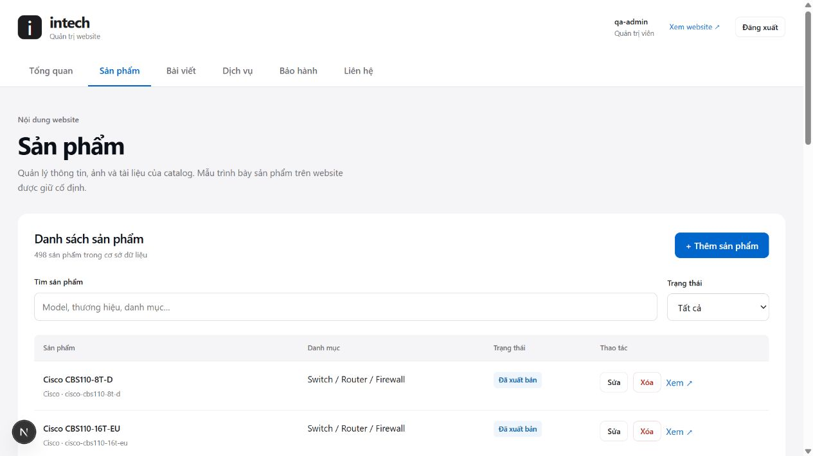
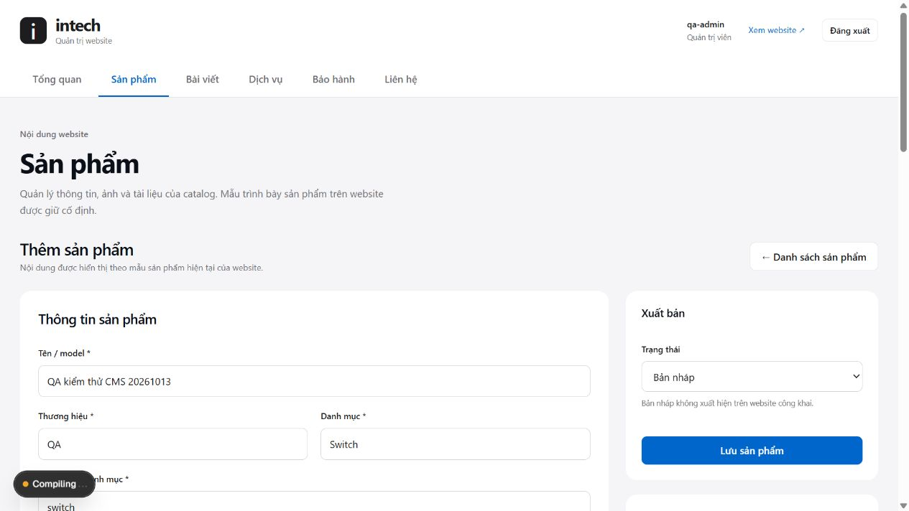
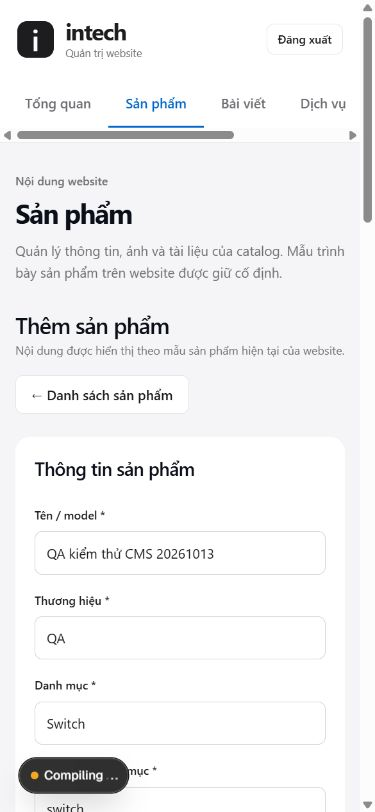
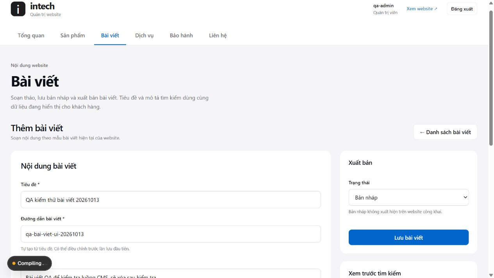

> Tài liệu lưu từ giai đoạn PostgreSQL, không phải hướng dẫn triển khai MySQL hiện tại. Xem [cPanel + MariaDB](../../CPANEL-MYSQL.md). Các kết quả database/restore cũ không chứng minh MariaDB iNET đã được kiểm tra.

# Kết quả kiểm thử — cập nhật 14/10/2026

## Môi trường và phạm vi

Người dùng xác nhận database `.env` là **thử nghiệm**, cho phép thay đổi và
dọn dữ liệu mẫu. Migration và giảm quyền runtime đã thực hiện trên môi trường
này. Dữ liệu gốc được giữ; fixture QA được tạo riêng rồi xóa. Email notification
bị tắt trong tiến trình QA để không gửi thư ra ngoài.

Không triển khai production/Sites. Markup sản phẩm và CSS public giữ nguyên;
metadata model không tồn tại dùng notFound thay vì tiêu đề trang chủ, và
public data layer bổ sung lọc nháp. Những thay
đổi public có sẵn trước lượt này trong working tree đã được giữ lại.

## Tự động và build

| Kiểm tra | Kết quả đã quan sát |
| --- | --- |
| `npm run lint` | TypeScript đạt |
| `npm test` cuối cùng | **100/100 đạt**, 0 fail, 0 skip |
| `npm run build` cuối cùng | Đạt, tạo **550/550 trang**, không có route/cờ lỗi QA |
| `npm run content:validate` | Đạt với 498 sản phẩm, 5 bài viết, 0 dịch vụ |
| Auth/security tests | Chữ ký/expiry/rotation/cookies/CSRF/role/MFA/TOTP replay/proxy bypass/killswitch |
| API tests | Kiểu/allowlist/body limit/ngày/URL/escaping/rate/magic bytes/runtime media |
| Content tests | Trường đầy đủ, duplicate slug, unknown/private fields, validate trước DB, import atomic |
| Backup tests | Target prod/same DB, checksum/count mismatch, public/.next path, junction/symlink |

## Rà soát bổ sung trước khi dùng thực tế

Theo yêu cầu kiểm tra production readiness, đã phát hiện dự án chỉ có404
mặc định và Next16.2.4 đang có advisory critical/high. Đã bổ sung404 Intech
tại `app/not-found.tsx` với CSS riêng, hướng dẫn quay lại trang chủ/catalog/
liên hệ. Đã cập nhật Next cùng major lên16.3.8, Sharp0.35.5 và PostCSS runtime
8.5.23; chuyển drizzle-kit sang devDependencies vì không được web runtime dùng.
Ở lần rà soát ban đầu,79/79 test và build556 trang đã đạt trên Next16.3.8.
Lần hoàn thiện cuối đạt100/100 và build550 (dịch vụ chuyển sang dynamic).
Xem [báo cáo hoàn thiện](completed-functions.md) với HTTP, session/MFA,
backup schema mới và thử500/retry trên bản production local.

Rà soát cuối còn kiểm chứng CAS credential bằng PostgreSQL thật, fingerprint
secret ban đầu, audit sau khi mutation thành công, đếm phiên còn hiệu lực và
health kiểm tra đủ bảng/cột/quyền. Service API nhận nội dung tiếng Việt hợp lệ
đến128KiB; các trang báo giá/bài viết dùng cùng trạng thái xuất bản của CMS.

Ngày14/10, một lần build sau cleanup lỗi kết nối Neon (`fetch failed`) ở hai
trang catalog. Cùng source chạy lại đạt550/550; giữ log lỗi và log đạt trong
[báo cáo hoàn thiện](completed-functions.md). Không thay dữ liệu/bỏ prerender
để làm build đạt. Chưa có kiểm thử tải hoặc SLA database trên production.

Cảnh báo ban đầu gồm8 dependency entries (1critical/2high/5moderate), không
phải8 lỗ hổng độc lập. Bản vá framework xử lý critical/high; dependency gián
tiếp baseline-browser-mapping được cập nhật riêng theo range hiện có.
Báo cáo runtime hiện tại: [runtime-audit.json](runtime-audit.json). Kết quả
npm audit chỉ là advisory đã biết của các package được quét, không phải chứng
nhận bảo mật toàn hệ thống. Advisory chính thức Next:
[Windows RCE](https://github.com/vercel/next.js/security/advisories/GHSA-p293-qw3h-jr36),
[release16.3.8](https://github.com/vercel/next.js/releases/tag/v16.3.8).

Sau cập nhật baseline-browser-mapping, `npm audit --omit=dev` trả **0 entries**
ở mọi severity. Full audit vẫn có4 moderate entries qua drizzle-kit/esbuild
tooling development; không force downgrade migration tooling và không đưa
drizzle-kit vào web production runtime.

Sandbox Windows ban đầu làm SWC không canonicalize workspace và chặn
`fs.realpath`/junction. Đã chạy lại bằng môi trường được phép ngoài sandbox.
Lần build trước migration biên dịch được nhưng prerender thất bại do thiếu
cột status; migration đã được áp dụng và build cuối đạt đầy đủ.

## HTTP và database thật

Kiểm tra 404 sau bổ sung và sau bản vá framework: URL sai/model/bài viết
không tồn tại trả 404, noindex và title 404. DOM có một H1 trong cả ba
trường hợp; màn hình mặc định 615px và mobile 390px không tràn ngang.
Đã sửa fallback metadata model thiếu để title không còn dùng trang chủ.
Bằng chứng: [http-readiness.json](http-readiness.json),
[browser-404.json](browser-404.json), [đánh giá go-live](production-readiness.md).

Kết quả có thể đọc ở [live-security.json](live-security.json) và
[live-upload.json](live-upload.json).

| Trường hợp | Kết quả |
| --- | --- |
| Không có session đọc admin API | 401, no-store |
| Gửi Basic Auth cũ | 401 |
| Login QA và đọc với cookie hợp lệ | 200 |
| Mutation thiếu Origin | 403 |
| Dữ liệu name là object | 400 |
| Host không được allowlist | 403 bằng HTTP client gửi Host thật |
| 5 request rate limit đồng thời, giới hạn 2 | 2 được nhận, 3 trả 429; DB counter=3 |
| 3 lần claim cùng TOTP counter đồng thời | Chỉ 1 thành công |
| Role runtime | Không superuser/createDB/createRole/bypassRLS/schemaCREATE/owner bảng |
| Upload PNG đặt tên client `.svg` | Server đặt UUID và extension `.png`, trả 200 |
| GET ảnh vừa upload sau startup | 200, image/png, nosniff, hash bytes khớp |

Kiểm thử Host ban đầu dùng fetch không gửi header Host override trên wire.
Đã đối chiếu với native HTTP, sửa harness và xác nhận allowlist chặn đúng.
Đây là khác biệt của client kiểm thử, không đổi chính sách auth để khớp test.

## Trình duyệt desktop/mobile

Đã đăng nhập, xem dashboard và danh sách DB thật qua preview local.

- Sản phẩm QA: tạo nháp thành công, public detail404; sửa tên giữ URL,
  2 thông số/2 ứng dụng/nhãn/ảnh còn nguyên; published dùng layout hiện có.
  Xóa QA xong danh sách trở về498.
- Bài viết QA: tạo nháp404, sửa tên giữ slug, xuất bản200. Heading/danh sách
  hiện đúng, một H1, `<script>` người nhập được escape thành text. Xóa xong
  bài viết DB trở về5.
- Liên hệ QA: dữ liệu được lưu, inbox tải được; đổi sang `đang xử lý` và
  reload vẫn giữ trạng thái. Xóa riêng fixture xong contacts trở về0.
- Product editor tại viewport390px: không có page horizontal overflow;
  navigation cuộn trong vùng riêng, editor xếp một cột.

Ảnh kiểm chứng:









Ảnh ghi lại fixture QA trong quá trình thử; các fixture này đã được dọn.

## Backup và restore thật

Archive riêng giữ tại `backups/intechna-neon-2026-10-13T06-08-54-572Z`.
Đây là logical PostgreSQL backup qua Neon HTTP; snapshot RepeatableRead,
schemaVersion1, checksum database và uploads. Không dùng file JSON nội dung
CMS thay cho backup dữ liệu khách hàng.

Restore đã chạy vào database QA rỗng **tách biệt với database nguồn**.
Đối soát độc lập đạt:

| Bảng | Rows | Canonical hash | Sequence |
| --- | ---: | --- | --- |
| products | 498 | Khớp | Khớp |
| posts | 5 | Khớp | Khớp |
| services | 0 | Khớp | Khớp |
| warranty | 3 | Khớp | Khớp |
| contact_submissions | 0 | Khớp | Khớp |

3 status CHECK constraints có mặt, security state được tạo rỗng. 2 file media
README hiện có checksum khớp; file upload PNG được kiểm tra riêng bằng HTTP.
Restore lần hai bị chặn bằng lỗi target không rỗng; hash và sequence vẫn
khớp sau khi bị chặn. Báo cáo redacted: [restore-verification.json](restore-verification.json).
Database QA này đã được xóa sau kiểm chứng; archive và báo cáo còn nguyên.

Giới hạn logical tooling: JSON DB128MiB, tổng archive512MiB, file16MiB,
100.000 rows/bảng. Với dữ liệu lớn hơn, dùng pg_dump/pg_restore hoặc dịch vụ
backup của chủ. Máy hiện không có pg_dump/psql, nên phương án binary dump
chưa thực thi. Tooling không sao lưu provider IAM/DNS/hosting hoặc secrets.

```powershell
npm run db:backup:neon
# Credentials target riêng trong env/secret storage; không đặt trong command.
node --env-file=.env.restore-target.local scripts/neon-restore.mjs <backup-directory>
node --env-file=.env.restore-target.local scripts/neon-verify-restore.mjs <backup-directory> <media-review-directory>
```

Restore target chỉ nhận development/staging, khác database nguồn/runtime và
rỗng. Assets phục hồi vào thư mục review riêng; không ghi đè public/uploads
đang chạy. Trước recovery production, chủ cần thử app trên target phục hồi,
xoay session secrets khi chuyển môi trường và đối chiếu dữ liệu thật.

## Dữ liệu bàn giao và cleanup

`data/owner/content.json`: 498 products / 5 posts / 0 services, không có dữ
liệu khách hàng hay credentials. `data/content.example.json` là cấu trúc mẫu.
`data/owner/admin-local-access.txt` chứa đăng nhập **development** mới và
được Git bỏ qua; kiểm tra boolean xác nhận đạt yêu cầu tối thiểu.
`.env` dùng DML role; `.env.maintenance.local` giữ owner credentials cho
maintenance và không được Next tự nạp như cấu hình web. Tất cả file secret,
data/owner và backups đã được kiểm tra Git ignore.

Kết quả DB cuối:498 products,5 posts,0 services,3 warranty,0 contacts. Dọn
fixture sản phẩm/bài viết/liên hệ/file upload và database restoreQA; không
xóa sản phẩm mẫu ban đầu. Rate fixture có hạn sử dụng; maintenance dọn bucket
hết hạn theo lịch, không cấp quyền DELETE rate table không dùng cho web.

## Chưa xác minh hoặc chưa triển khai

- Production accounts/MFA thật và secret manager của chủ. UI/password/MFA và
  maintenance recovery đã triển khai, thử bằng account QA riêng.
- Cloud IAM, IP allowlist/private networking, encryption/retention provider,
  và tách dev/production trên tài khoản của chủ.
- Người nhận alert, uptime monitoring, lịch backup tự động và full hosting DR.
- pg_dump/pg_restore, tải lớn và object storage thay filesystem.
- Gửi email phản hồi khách hàng; không có email kiểm thử nào được gửi ra ngoài.
- Scan secret toàn bộ Git history; scan current tracked files không thấy mẫu
  credential, kết quả này không chứng minh secrets chưa từng xuất hiện ở history.

Không dùng kết quả môi trường thử nghiệm để khẳng định production đã an toàn.
