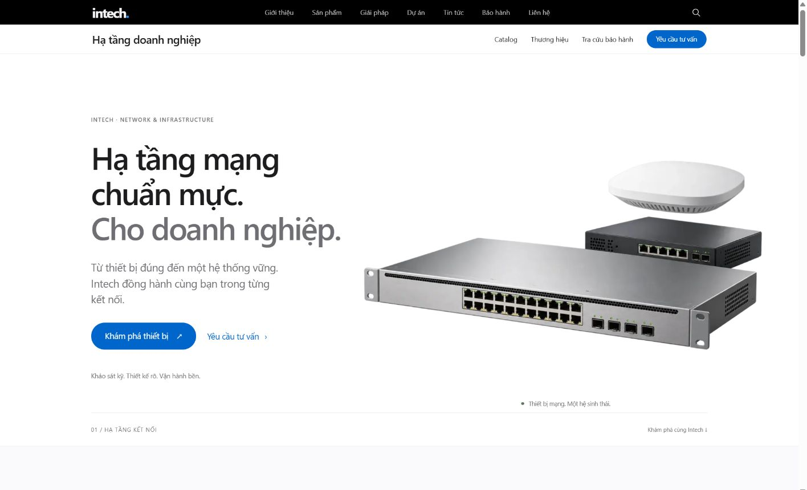
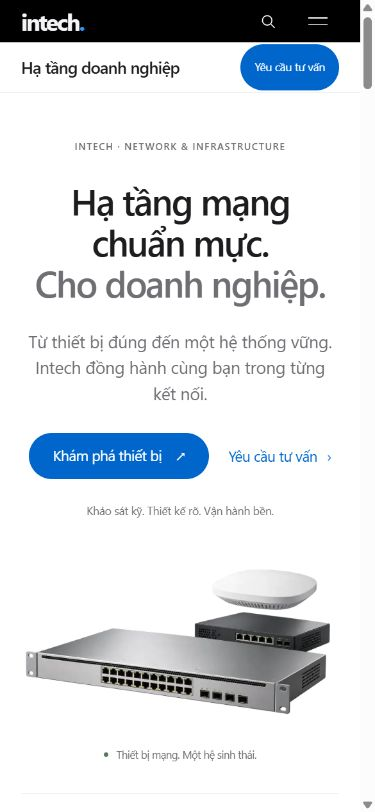
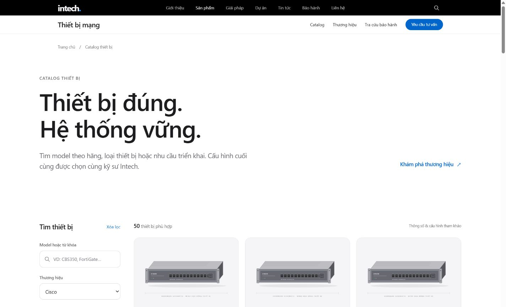
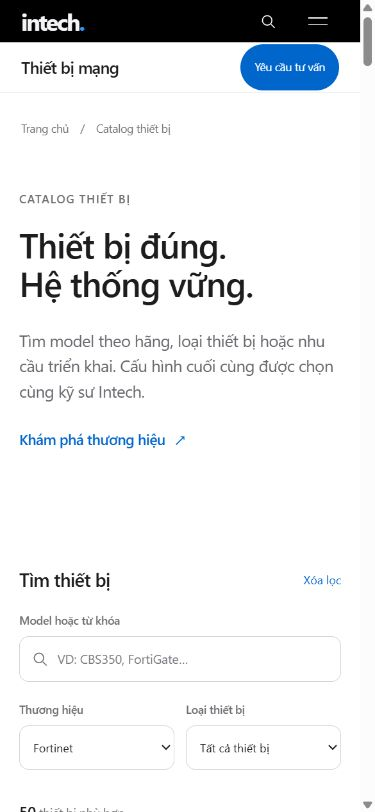

# Đối soát giao diện Intech

Hoàn thiện ngày 13/10/2026 theo bản Intech Redesign Master Plan đã cung cấp.
Mã nguồn nằm trong ứng dụng Next.js hiện có, tại `D:\intechna-web\intechna-web`.

## Giao diện đã thực hiện

| Phần | Kết quả |
| --- | --- |
| Điều hướng | Global nav đen 44 px, local nav kính mờ 52 px, trạng thái trang hiện tại, menu điện thoại, skip link và focus rõ ràng. |
| Trang chủ | Hero thiết bị, sơ đồ kết nối, bento tiêu chuẩn triển khai, showcase ngang, giải pháp theo ngành, cam kết, tra cứu bảo hành tại chỗ và form tư vấn. |
| Chuyển động | GSAP được tải riêng; cuộn ngang, đường kết nối, thẻ giải pháp và chữ đổi theo cuộn trên desktop. Mobile và chế độ giảm chuyển động dùng bố cục đọc thông thường. |
| Sản phẩm | Hub danh mục, trang danh mục, catalog có tìm kiếm/lọc/phân trang, trang model với thông số và datasheet khi có dữ liệu. |
| Thương hiệu | Danh sách hãng và catalog theo hãng dùng cùng nguồn dữ liệu PostgreSQL. |
| Bảo hành | Kiểm tra mã, loading, còn hạn/hết hạn, chưa có dữ liệu, lỗi kết nối; thông tin khách hàng được che tại server. |
| Trang phụ | Giới thiệu, giải pháp, dịch vụ, dự án, tin tức, liên hệ và báo giá dùng chung typography, CTA và footer mới. |

Tám ảnh WebP thiết bị có tổng dung lượng khoảng 405 KiB. Đây là render minh họa
dòng thiết bị; thông số model lấy từ dữ liệu catalog. Nguồn ảnh và cách chuyển
đổi được ghi trong [hardware README](../../public/images/hardware/README.md).

## Mã và file đã dọn

- Bỏ route demo `/ui-preview` và bảy component hiệu ứng chỉ được demo sử dụng.
- Bỏ `PageTransition`, helper lưu JSON `admin-store`, truy vấn bảo hành công khai
  cũ không còn nơi gọi và helper class không sử dụng.
- Bỏ cấu hình registry, ESLint của Vite, sprite icon cũ, lockfile rỗng tại thư mục
  cha và bundle Vite `dist/`.
- Bỏ dependency `motion`, `@gsap/react`, `clsx`, `tailwind-merge` không còn import.
- Tách CSS thành tokens, public, home, catalog, warranty và admin; bỏ các utility
  kích thước không có nơi dùng.
- Chuẩn hóa format bằng Prettier và thêm lệnh kiểm tra format.
- Chuyển `middleware.ts` sang `proxy.ts` theo convention Next.js 16, giữ logic
  xác thực quản trị hiện có.

Đối soát import không thấy tham chiếu đến file đã xóa. Schema cơ sở dữ liệu,
route quản trị, dữ liệu, backup và công cụ seed được giữ nguyên. Không chạy
migration, seed, gửi form liên hệ thật hoặc thao tác ghi dữ liệu quản trị.

## Kết quả kiểm tra

| Kiểm tra | Kết quả |
| --- | --- |
| `npm test` | 7/7 qua: bộ lọc catalog, query, che dữ liệu khách hàng và hạn bảo hành theo giờ Việt Nam. |
| `npm run lint` | TypeScript không lỗi; script này không chạy ESLint. |
| `npm run format:check` | Qua với các file public và thành phần đã thay đổi. |
| `npm run build` | Production build thành công, gồm 557 trang được tạo trước. |
| `git diff --check` | Không có lỗi whitespace. |
| Desktop 1440 × 900 | Hero hiển thị đúng, ảnh tải được, không tràn ngang. |
| Mobile 390 × 844 | Trang chủ, catalog và bảo hành không tràn ngang; menu mở/đóng, Escape trả focus về menu. |
| Catalog trong trình duyệt | Cisco + Switch trả 50 model; thay hãng cập nhật URL/kết quả; Back/Forward khôi phục bộ lọc; từ khóa không tồn tại có trạng thái trống. |
| Bảo hành trong trình duyệt | Mã `123` bị từ chối; mã QA không tồn tại trả thông báo tại chỗ trên trang chủ. |
| HTTP production | `/admin` và `/api/admin/products` trả 401 khi chưa xác thực; mã ngắn trả 400, mã QA không tồn tại trả 200/null. |
| Console | Không thấy warning/error trong các luồng kiểm tra production. |

Các trường hợp còn hạn, hết hạn và ngày không hợp lệ được kiểm tra bằng dữ
liệu giả trong unit test. Không tra cứu hồ sơ khách hàng thật để chụp ảnh.
Chưa đo Lighthouse, LCP hoặc FPS trên thiết bị thật; không coi các mục tiêu
hiệu năng trong bản kế hoạch là kết quả đã đạt.

## Ảnh đối chiếu

Ảnh chụp bản production tại localhost. Thay đổi cuối sau ảnh chỉ loại bỏ CSS
không sử dụng, không thay đổi bố cục.

### Trang chủ desktop



### Trang chủ điện thoại



### Catalog desktop



### Catalog điện thoại



### Tra cứu bảo hành trên trang chủ


## Chạy và triển khai

```powershell
cd D:\intechna-web\intechna-web
npm run dev
```

Hoặc chạy bản production với `npm run build` rồi `npm start`.
Ứng dụng cần Next.js server, PostgreSQL và lưu trữ bền vững cho upload hiện có.
Chưa publish lên Sites: bản Next.js này cần bước tích hợp backend/lưu trữ trước
khi chuyển sang môi trường hosting của Sites. Không có URL production mới được
tạo trong lần hoàn thiện này.
