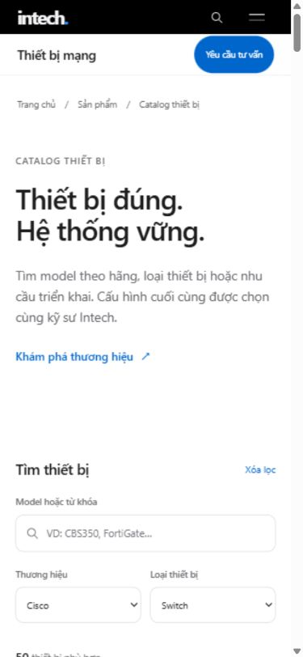
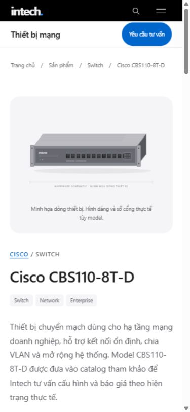
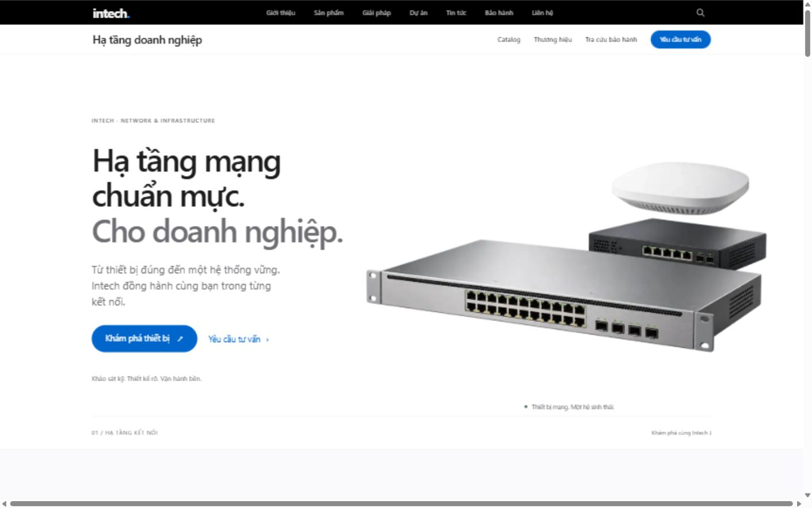

# Hoàn thiện SEO giao diện người dùng

Kiểm tra ngày 13/10/2026. Mã nguồn đã sửa và kiểm tra bằng bản production
ở localhost; chưa triển khai các thay đổi này lên tên miền chính.
Tất cả sửa và lệnh build/start chạy trong **`D:\intechna-web\intechna-web`**,
trên giao diện mới của project cục bộ. Link online chỉ dùng để đọc số liệu
tham chiếu, không phải nơi sửa code hay nơi kiểm tra giao diện mới.
Bố cục, hình ảnh, nội dung thẻ sản phẩm và cách tìm/lọc được giữ nguyên.
Không sửa các trang, API hoặc cơ chế xác thực quản trị.

## Tên miền và lỗi trên bản đang online

`https://switchcu.vn` hiện chuyển đến `https://www.switchcu.vn`, nên origin
canonical mặc định là **`https://www.switchcu.vn`**. Tại thời điểm kiểm tra,
trang chủ online khai báo canonical `https://intechna.vn`, robots khai báo
sitemap của `intechna.vn`, và 542 URL trong sitemap online đều dùng tên miền
đó. Lighthouse vẫn chấm SEO 100; điểm này không phát hiện đầy đủ việc chọn
sai tên miền canonical.

Đã sửa trong mã nguồn để canonical, OG/Twitter, robots, sitemap và mọi URL
trong schema cùng lấy từ `siteConfig.domain`. Bản robots đúng convention
Next.js là `app/robots.ts`, tự sinh `/robots.txt`.

Bằng chứng bản online trước triển khai: [robots](live-robots.txt),
[sitemap](live-sitemap.xml), [PageSpeed mobile](pagespeed-live-mobile.txt),
[PageSpeed desktop](pagespeed-live-desktop.txt).

## Các mục đã xử lý

| Mục                                       | Kết quả                                                                                                                                                                                  |
| ----------------------------------------- | ---------------------------------------------------------------------------------------------------------------------------------------------------------------------------------------- |
| Trang chủ                                 | Một H1, metadata riêng, WebPage + WebSite + ProfessionalService, ưu tiên tải ảnh hero.                                                                                                   |
| Danh mục cha                              | `/san-pham` là trang tổng hợp; CollectionPage/ItemList khớp các danh mục thực.                                                                                                           |
| Danh mục con                              | `/san-pham/[slug]`; danh mục từ DB có route khi slug hợp lệ, H1 theo danh mục, breadcrumb về Sản phẩm, schema khớp model đang hiển thị.                                                  |
| Catalog và phân trang                     | Giữ URL hiện có. Trang 2 trở đi tự canonical; trang không hợp lệ trả 404. ItemList khớp 24 model của trang hiện tại.                                                                     |
| URL lọc/tìm kiếm                          | `q`, `brand`, `category` có `noindex, follow`, canonical về trang danh sách sạch. Không chặn bằng robots để bot đọc được noindex.                                                        |
| Trang sản phẩm                            | ItemPage chứa Product theo tên, hãng, loại, mô tả và ảnh thật nếu có. Breadcrumb Trang chủ → Sản phẩm → Danh mục → Model.                                                                |
| Thương hiệu                               | CollectionPage theo hãng, metadata/heading riêng, breadcrumb đúng cấp và URL hãng thống nhất cách tạo slug.                                                                              |
| Danh sách bài viết                        | `/tin-tuc` là CollectionPage + Blog. Mô hình hiện chưa có danh mục bài viết riêng; không tạo taxonomy hay URL rỗng.                                                                      |
| Bài viết                                  | BlogPosting, tác giả/tổ chức xuất bản thật, ngày xuất bản thật khi có. Danh sách, trang chi tiết và sitemap cùng nguồn CMS + bài tĩnh.                                                   |
| Nội dung bài viết                         | Các bài tĩnh có nội dung riêng theo chủ đề; CMS có body được ưu tiên. Bài CMS hẹn xuất bản chưa xuất hiện công khai. Body rỗng của bài seed vẫn giữ bài đầy đủ theo đúng chủ đề.         |
| Dịch vụ/giải pháp                         | Service theo nội dung từng trang; trang tổng hợp dùng CollectionPage/ItemList, breadcrumb liên kết đúng trang cha.                                                                       |
| Giới thiệu/liên hệ/báo giá/dự án/bảo hành | AboutPage, ContactPage, CollectionPage hoặc WebPage phù hợp nội dung; tra cứu bảo hành có query được noindex.                                                                            |
| Heading                                   | Mỗi trang công khai kiểm tra có một H1. Card danh mục dùng H3 dưới heading khu vực H2, giữ kiểu hiển thị. Heading slogan được bổ sung mô tả cho công nghệ hỗ trợ mà không đổi hình thức. |
| Breadcrumb                                | Có link từng cấp cha, trang hiện tại có aria-current; BreadcrumbList dùng URL tuyệt đối cùng tên miền canonical.                                                                         |
| Robots                                    | Cho phép public và tài nguyên render, chặn admin/API cả đường dẫn gốc và cấp con. Có host và sitemap canonical.                                                                          |
| Sitemap                                   | Đọc dữ liệu public thực tế, không dùng catalog seed, không query/admin/API, không URL trùng. Sinh động để cập nhật danh sách sau khi dữ liệu thay đổi.                                   |
| Lastmod                                   | Bỏ thời gian request giả. DB chưa lưu updatedAt nên không khai ngày cập nhật không có căn cứ.                                                                                            |
| Favicon                                   | Thay icon mẫu bằng monogram Intech; SVG vuông, PNG 48×48, Apple icon 180×180; thêm logo wordmark cho schema tổ chức.                                                                     |
| An toàn JSON-LD                           | Serialize có escape để nội dung CMS không kết thúc được thẻ script.                                                                                                                      |
| Ảnh                                       | Ảnh sản phẩm local dùng Next Image với kích thước/sizes; ảnh lỗi quay về minh họa hiện có. Không khai minh họa thành ảnh sản phẩm thật trong Product.                                    |
| Mobile/khả năng dùng                      | Không tràn ngang; menu mở/đóng, Escape trả focus, bộ lọc và Back hoạt động; sửa các lỗi tương phản cụ thể và dấu hiệu liên kết.                                                          |

Google yêu cầu `lastmod` phản ánh một cập nhật có ý nghĩa và có thể xác minh;
bỏ trường này khi chưa có ngày đáng tin cậy là hợp lý.
[Hướng dẫn sitemap](https://developers.google.com/search/docs/crawling-indexing/sitemaps/build-sitemap).

## Sao đánh giá và bình luận

Bạn xác nhận chưa có đánh giá thật. DB hiện cũng chưa lưu giá bán, tồn kho
hoặc dữ liệu đánh giá. Vì vậy không thêm số sao, số lượt đánh giá, giá 0 hay
trạng thái còn hàng giả. Không thêm khối bình luận trống chỉ để phục vụ SEO.

Product hiện là dữ liệu mô tả hợp lệ theo Schema.org, nhưng chưa đủ điều kiện
để khẳng định Google hiển thị product/star rich results. Cần review/rating
thật hiển thị trên trang, hoặc offer có giá thật tùy loại rich result. Việc
hiển thị rich result vẫn do Google quyết định.
[Product snippets](https://developers.google.com/search/docs/appearance/structured-data/product-snippet),
[quy định review](https://developers.google.com/search/docs/appearance/structured-data/review-snippet).

## Kiểm tra production và mobile

| Kiểm tra                       | Kết quả                                                                                                                      |
| ------------------------------ | ---------------------------------------------------------------------------------------------------------------------------- |
| Unit/regression tests          | 39/39 qua: dữ liệu bài viết, schema, escaping, domain, sitemap, filters, phân trang, payload và HTTP parser.                 |
| TypeScript và production build | Qua; build tạo 556 trang tĩnh, các route có query và sitemap phục vụ động.                                                   |
| Prettier                       | Qua với các file public và các helper/script JavaScript mới.                                                                 |
| HTTP toàn bộ sitemap           | 541 URL canonical đều trả HTTP 200.                                                                                          |
| Link nội bộ, query và 404      | 42 URL kiểm tra thêm; tổng 583 trang/luồng, 0 lỗi.                                                                           |
| Metadata/schema                | H1, title/description, canonical/OG, JSON-LD, breadcrumb, ItemList và kiểu schema tương ứng đều qua kiểm tra server HTML.    |
| Tài nguyên                     | 12 tài nguyên GET 200 và giải mã ảnh thành công; kích thước favicon/Apple đúng.                                              |
| Mobile 390×844                 | Trang chủ, catalog, danh mục, sản phẩm, thương hiệu, bài viết và bảo hành không tràn ngang, ảnh không lỗi.                   |
| Mobile 320×568                 | Trang chủ và danh mục không tràn ngang.                                                                                      |
| Desktop 1440×900               | Trang chủ không tràn ngang, giữ bố cục.                                                                                      |
| Thao tác                       | Cisco + Switch trả 50 model; từ khóa không tồn tại trả trạng thái trống; Back khôi phục bộ lọc; breadcrumb mở đúng danh mục. |
| Console                        | Không thấy warning/error trong luồng browser đã kiểm tra.                                                                    |
| Đổi domain giả lập             | Canonical, robots, sitemap và organization URL cùng chuyển sang origin mới chỉ với NEXT_PUBLIC_SITE_URL.                     |

[Báo cáo HTTP đầy đủ](http-audit.json), [kiểm tra mobile](mobile-checks.json).
498 cảnh báo Product trong báo cáo HTTP là giới hạn rich results đã mô tả ở
trên; không phải lỗi URL hoặc JSON-LD syntax. Bộ audit này kiểm tra cú pháp và
các thuộc tính cụ thể của dự án, không thay thế Google Rich Results Test.

Không gửi form liên hệ thật, không ghi dữ liệu khách hàng và không chạy
seed/migration. Những thay đổi có sẵn trong workspace được giữ lại.

## Hiệu năng

Đã giữ ảnh WebP và font hệ thống, tải GSAP sau khi trang sẵn sàng và chỉ trên
desktop đủ điều kiện; mobile/chế độ giảm chuyển động không cần tải GSAP.
CSS trang chủ, catalog và bảo hành được tách theo nơi sử dụng. Dữ liệu truyền
cho CatalogFilter chỉ gồm thông số và badge mà card hiển thị; chi tiết sản
phẩm vẫn dùng dữ liệu đầy đủ. Với bộ kiểm thử 499 model, JSON giảm từ 373.105
xuống 272.664 byte (26,9%), giữ nguyên kết quả tìm kiếm/card.

Lighthouse 13.5.0 đo **giao diện mới trong project trên máy**, tại
`http://127.0.0.1:3000`, với mô phỏng mobile/desktop:

| Trang               | Performance | Accessibility | Best Practices | SEO | LCP      | CLS | TBT    |
| ------------------- | ----------: | ------------: | -------------: | --: | -------- | --- | ------ |
| Trang chủ mobile    |          91 |           100 |            100 | 100 | 3,2 giây | 0   | 110 ms |
| Trang chủ desktop   |         100 |           100 |            100 | 100 | 0,7 giây | 0   | 0 ms   |
| Catalog mobile      |          97 |           100 |            100 | 100 | 2,0 giây | 0   | 90 ms  |
| Danh mục con mobile |          91 |           100 |            100 | 100 | 2,5 giây | 0   | 160 ms |
| Sản phẩm mobile     |          97 |           100 |            100 | 100 | 2,2 giây | 0   | 160 ms |
| Bài viết mobile     |          97 |           100 |            100 | 100 | 2,4 giây | 0   | 90 ms  |
| Thương hiệu mobile  |          89 |           100 |            100 | 100 | 2,4 giây | 0   | 110 ms |

[Tổng hợp kết quả](lighthouse-summary.json),
[trang chủ mobile](lighthouse-home-mobile.report.html),
[trang chủ desktop](lighthouse-home-desktop.report.html),
[catalog](lighthouse-catalog-mobile.report.html),
[danh mục](lighthouse-category-mobile.report.html),
[sản phẩm](lighthouse-product-mobile.report.html),
[bài viết](lighthouse-article-mobile.report.html),
[thương hiệu](lighthouse-brand-mobile.report.html).

Đây là các lần đo lab riêng, điểm có thể dao động theo tải máy và độ trễ DB.
LCP trang chủ mobile 3,2 giây còn cao hơn ngưỡng tốt 2,5 giây; không khẳng
định Core Web Vitals đã đạt. Sau triển khai cần đo lại đúng bản mới trên
domain thật và xem dữ liệu người dùng thực tế. SEO/Accessibility 100 ở bảng
trên chỉ là kết quả các mục Lighthouse kiểm tra.

PageSpeed Insights đo **bản đang online trước triển khai, khác giao diện mới
trong project**, ngày 13/10/2026, chỉ làm số liệu tham chiếu:

| Thiết bị | Performance | Accessibility | Best Practices | SEO | LCP      | CLS   | TBT   |
| -------- | ----------: | ------------: | -------------: | --: | -------- | ----- | ----- |
| Mobile   |          98 |            96 |            100 | 100 | 2,2 giây | 0     | 30 ms |
| Desktop  |         100 |            96 |            100 | 100 | 0,4 giây | 0,001 | 30 ms |

[Báo cáo PageSpeed thực tế](https://pagespeed.web.dev/analysis/https-switchcu-vn/u2u0ozv5ah?form_factor=mobile).
Đây là điểm của bản online đang dùng giao diện cũ hơn trong checkout hiện
tại; không dùng để khẳng định hiệu năng của bản sửa chưa triển khai.

PageSpeed báo **No Data** cho trải nghiệm người dùng thực tế. Chưa thể kết
luận Core Web Vitals đã đạt; cần dữ liệu CrUX/Search Console đủ mẫu trong
khoảng đo thực tế. LCP/CLS/TBT của Lighthouse là dữ liệu lab; TBT không phải
INP. [Giải thích PSI và dữ liệu 28 ngày](https://developers.google.com/speed/docs/insights/v5/about).

Test My Site đã ngừng cung cấp; URL cũ chuyển đến bài hướng dẫn chính thức
của Google khuyến nghị PageSpeed Insights.
[Thông báo Google](https://business.google.com/en-all/think/future-of-marketing/mobile-tools-to-optimize-site-and-app/).
Google cũng đã ngừng Mobile-Friendly Test; kiểm tra responsive thực tế và
Lighthouse được dùng ở lần này.
[Thông báo Mobile-Friendly Test](https://developers.google.com/search/blog/2016/05/a-new-mobile-friendly-testing-tool).

## Đổi tên miền trong tương lai và triển khai

Đặt origin chính thức trong biến môi trường hosting, ví dụ hiện tại:

```dotenv
NEXT_PUBLIC_SITE_URL=https://www.switchcu.vn
```

Khi đổi domain, thay biến này và build/deploy lại; NEXT_PUBLIC được đóng gói
vào bundle trình duyệt lúc build. Không sửa riêng từng canonical/schema.
Email/điện thoại/tên doanh nghiệp là dữ liệu độc lập với domain và giữ nguyên.

Khi chuyển tên miền thật, cấu hình DNS/TLS và chuyển hướng vĩnh viễn từ tên
miền cũ sang đường dẫn tương ứng ở tên miền mới, giữ path/query. Xác minh
property mới trong Search Console, gửi sitemap mới và dùng Change of Address
khi phù hợp; không chỉ đổi canonical rồi bỏ tên miền cũ.
[Hướng dẫn Google về chuyển domain](https://developers.google.com/search/docs/crawling-indexing/site-move-with-url-changes).

Sau triển khai, chạy lại audit HTTP với domain thực tế và Google Rich Results
Test/URL Inspection. Chỉ lúc đó các sửa canonical/robots/sitemap ở trên mới
có hiệu lực trên website online.

```powershell
node scripts/audit-public-seo.mjs --base https://www.switchcu.vn --canonical-origin https://www.switchcu.vn --output docs/seo/http-audit-production.json
```

Đo lại Lighthouse ở localhost (cần Chrome, Node/npm và Lighthouse đã có
trong cache npm; cài bằng npm exec nếu chưa có):

```powershell
npm exec --yes --package=lighthouse -- lighthouse --version
./scripts/audit-performance.ps1
```

Script hiệu năng chạy tuần tự để các Chrome headless không tranh CPU; mỗi
trang có báo cáo JSON và HTML trong thư mục này. Nếu sản phẩm mẫu trong
script được thay/xóa, chọn một URL sản phẩm tồn tại để đo lại.

## Ảnh kiểm tra giao diện





