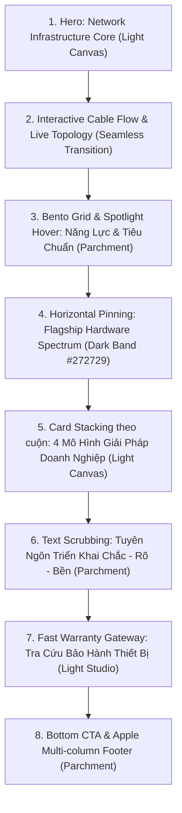
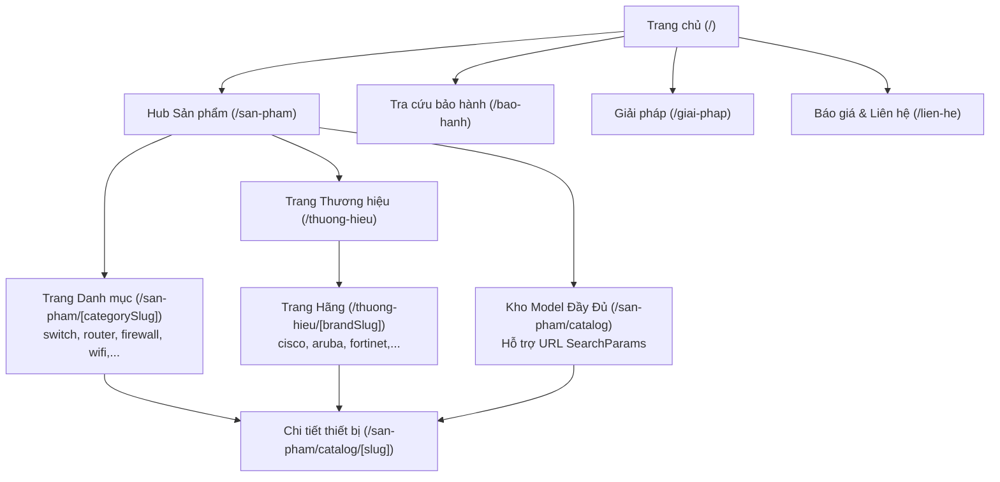

# Kế Hoạch Thiết Kế Lại Website Intech (Intech Redesign Master Plan)

> **Role:** Product Designer, UX Designer & Frontend Architect  
> **Dự án:** Intech Website (`intechna-web`) — Giải pháp & Thiết bị mạng doanh nghiệp  
> **Ngôn ngữ thiết kế:** Apple Design Language (`apple-DESIGN.md`) kết hợp Interactive Technology Motion  
> **Trạng thái:** Kế hoạch kiến trúc (Chưa can thiệp code/dữ liệu cho đến khi được duyệt)

---

## 1. Mục tiêu, Phạm vi, Ưu tiên & Giả định

### 1.1. Mục tiêu dự án
1. **Định vị thương hiệu cao cấp:** Chuyển dịch diện mạo từ website công ty thi công truyền thống thành **đơn vị tư vấn, cung cấp giải pháp hạ tầng mạng & thiết bị viễn thông cấp doanh nghiệp (Enterprise Grade)**.
2. **Ngôn ngữ Apple thuần khiết + Tinh thần công nghệ:** Thực thi triết lý *Product-First*, nhịp điệu tương phản giữa các mảng không gian trắng/off-white và dải sản phẩm tối; giao diện tối giản chrome trang trí để hình ảnh thiết bị và sơ đồ mạng làm trung tâm.
3. **Trải nghiệm tìm kiếm & chuyển đổi rõ ràng:** Phân luồng minh bạch giữa 3 nhu cầu cốt lõi của khách hàng B2B:
   - Duyệt & lọc thiết bị theo **Loại phần cứng (Switch/Router/WiFi/Firewall)** và **Hãng (Cisco, Aruba, Fortinet,...)**.
   - Tra cứu bảo hành chính xác, bảo mật và tốc độ cao.
   - Gửi yêu cầu tư vấn cấu hình / báo giá dự án nhanh chóng.
4. **Hiệu năng & Khả năng tiếp cận cao (Accessibility & Performance):** Đạt 60–120 FPS chuyển động, LCP < 1.8s, không jank cuộn chuột, bảo toàn khả năng đọc khi tắt JavaScript hoặc kích hoạt `prefers-reduced-motion`.

---

### 1.2. Phạm vi triển khai (Scope)
* **Trong phạm vi đợt Redesign:**
  - **Hệ thống điều hướng chung:** Global Nav, Sub-nav Frosted Glass, Footer đa cột chuẩn Apple.
  - **Trang chủ (`/`):** Tái thiết kế toàn bộ storyboard với hero phần cứng mạng, cáp dữ liệu SVG, Card Stacking, Bento Grid + Spotlight hover, Horizontal Showcase và Text Scrubbing.
  - **Hệ thống sản phẩm:**
    - Hub giải pháp & danh mục: `/san-pham`
    - Bộ lọc & danh sách model: `/san-pham/catalog` (hỗ trợ URL query params đồng bộ hai chiều)
    - Trang chi tiết thiết bị: `/san-pham/catalog/[slug]`
    - Trang thương hiệu: `/thuong-hieu` và `/thuong-hieu/[slug]`
    - Trang danh mục: `/san-pham/[slug]` (Switch, Router, Firewall, WiFi,...)
  - **Tra cứu bảo hành (`/bao-hanh`):** Tái cấu trúc UX/UI, che thông tin nhạy cảm, tối ưu debounce và trạng thái phản hồi.
  - **Design System & CSS Tokens:** Tích hợp bộ biến Apple Tokens vào Next.js App Router mà không gây xung đột với reset CSS hiện có.
* **Ngoài phạm vi:**
  - Khu vực quản trị (`/admin/*`) giữ nguyên logic backend và giao diện hiện hành.
  - Schema PostgreSQL và database migrations giữ nguyên; không thay đổi cấu trúc bảng Drizzle.

---

### 1.3. Ưu tiên hành động (CTA Hierarchy) & Người dùng mục tiêu
* **Đối tượng người dùng mục tiêu:**
  1. *IT Manager / Kỹ sư hạ tầng doanh nghiệp:* Cần tra thông số kỹ thuật chuẩn (cổng, PoE, throughput, datasheet PDF), kiểm tra độ tương thích hãng.
  2. *Chủ đầu tư / Trưởng phòng mua sắm dự án:* Cần khảo sát hiện trạng, báo giá nhanh theo dự toán, đảm bảo cam kết bảo hành và xuất xứ chính hãng.
  3. *Khách hàng đang vận hành hệ thống:* Cần kiểm tra thời hạn bảo hành thiết bị theo Serial / Mã phiếu Intech để bảo trì.
* **Thứ tự ưu tiên CTA:**
  - **Ưu tiên 1 (Core Conversion):** *Xem Catalog Thiết Bị* & *Liên Hệ Báo Giá / Khảo Sát* (Nút Action Blue Pill nổi bật tại Hero và Persistent Sub-nav).
  - **Ưu tiên 2 (Quick Utility):** *Tra Cứu Bảo Hành Nhanh* (Pill Search lối tắt trên Header / Floating Search Bar).
  - **Ưu tiên 3 (Direct Contact):** *Hotline Kỹ Thuật 24/7* (Nút tròn nhỏ icon điện thoại & Footer).

---

### 1.4. Kiểm kê hiện trạng tài nguyên & Giả định kỹ thuật (Verified Audit)
* **Thực trạng assets hình ảnh:**
  - Thư mục `public/` hiện có **0 ảnh chụp thiết bị tĩnh**.
  - Toàn bộ 11.993 dòng code trong `app/products-data.ts` chưa có `imageUrl`.
  - Dự án đang sử dụng component `ProductPlaceholder.tsx` (vector SVG vẽ Switch, AP, Firewall, Router, NAS).
* **Chiến lược hình ảnh Hybrid (đã thống nhất qua /grill-me):**
  - **Tầng 1 (Flagship Assets):** Tạo/chuẩn hóa bộ ảnh render WebP trong suốt chất lượng cao cho **8–12 thiết bị chủ lực** (Cisco Catalyst/CBS Switch, Fortinet FortiGate, Aruba AP, MikroTik Router, Synology NAS) dùng riêng cho Hero, Bento Grid và Horizontal Scroll.
  - **Tầng 2 (Schematic Hardware Engine):** Nâng cấp `ProductPlaceholder.tsx` thành **Apple Industrial Schematic Generator** — phong cách bản vẽ kỹ thuật tối giản (isometric/flat kỹ nghệ cao, đường nét mảnh 1px, LED trạng thái chân thực, phối màu đơn sắc Titanium/Space Black) áp dụng cho hàng trăm model còn lại trong catalog.
* **Kiểm tra công nghệ & TypeScript:**
  - Lệnh `npm run lint` (`tsc --noEmit`) chạy **thành công không có lỗi** (exit code 0).
  - Dependencies sẵn sàng: `motion` (v14), `gsap` (v3.15) với `ScrollTrigger` và `@gsap/react`, `tailwindcss` (v4.3.3) qua `@tailwindcss/postcss`, `clsx`, `tailwind-merge`.
  - Không nạp Tailwind Preflight để bảo toàn tính ổn định của layout reset.

---

## 2. Concept Thị Giác, Design Tokens & Sự Hòa Hợp Apple

### 2.1. Triết lý thẩm mỹ: Museum Gallery for Network Hardware
Website tiếp cận sản phẩm mạng như những tác phẩm kỹ thuật chính xác:
* **UI Chrome lùi lại (Receding UI):** Loại bỏ viền gradient sặc sỡ, shadow thẻ dày đặc kiểu SaaS cũ. Khung viền chỉ dùng hairline 1px siêu mảnh (`rgba(0,0,0,0.08)` trên nền sáng, `rgba(255,255,255,0.08)` trên nền tối).
* **Nhịp điệu Canvas (Rhythm):** Nhịp cuộn tương phản tuần hoàn:
  $$\text{Canvas White (\#ffffff)} \longrightarrow \text{Dark Band (\#272729)} \longrightarrow \text{Canvas Parchment (\#f5f5f7)} \longrightarrow \text{Dark Band} \longrightarrow \text{Footer}$$
* **Bóng đổ duy nhất:** Chỉ duy nhất ảnh thiết bị vật lý nằm trên mặt sàn mới có bóng đổ tiếp xúc (`rgba(0, 0, 0, 0.22) 3px 5px 30px 0px`). Thẻ UI, nút bấm và chữ **tuyệt đối không dùng drop-shadow**.

---

### 2.2. Bảng Design Tokens Apple chuẩn hóa

```css
:root {
  /* ── Interactive Accent (Duy nhất 1 màu hành động) ── */
  --apple-action-blue:       #0066cc; /* Nút chính, text link */
  --apple-action-hover:      #0071e3; /* Trạng thái hover/focus */
  --apple-action-dark:       #2997ff; /* Link & nút trên nền tối */

  /* ── Canvas & Surfaces ── */
  --apple-canvas:            #ffffff; /* Nền trắng tuyệt đối */
  --apple-parchment:         #f5f5f7; /* Off-white đặc trưng Apple */
  --apple-surface-pearl:     #fafafc; /* Nút capsule thứ cấp */
  --apple-tile-dark-1:       #272729; /* Dải tối chính */
  --apple-tile-dark-2:       #2a2a2c; /* Dải tối chuyển tiếp */
  --apple-surface-black:     #000000; /* Global nav bar, video frame */

  /* ── Typography & Ink ── */
  --apple-ink:               #1d1d1f; /* Màu chữ chuẩn trên nền sáng */
  --apple-ink-muted-80:      #333333;
  --apple-ink-muted-48:      #7a7a7a; /* Caption, ghi chú */
  --apple-ink-on-dark:       #ffffff; /* Chữ trên nền tối */
  --apple-ink-muted-dark:    #86868b; /* Chữ phụ trên nền tối */

  /* ── Borders & Separators ── */
  --apple-hairline:          rgba(0, 0, 0, 0.08);
  --apple-hairline-dark:     rgba(255, 255, 255, 0.12);
  --apple-divider:           #f0f0f0;

  /* ── Border Radii (Hệ bán kính chuẩn) ── */
  --radius-none:             0px;     /* Full-bleed sections */
  --radius-sm:               8px;     /* Utility rects */
  --radius-md:               11px;    /* Pearl buttons */
  --radius-lg:               18px;    /* Bento cards, Product cards */
  --radius-pill:             9999px;  /* Action buttons, Search pill */

  /* ── Shadows ── */
  --apple-product-shadow:    0 20px 40px rgba(0, 0, 0, 0.22);
}
```

---

### 2.3. Typography cho Tiếng Việt & Font Fallback Đa Nền Tảng
Để đạt được cảm giác **"Apple Tight Tracking"** mà không bị lỗi dấu tiếng Việt (bị đè dấu thanh trên Windows/Android):

```css
/* Stack phông chữ ưu tiên hệ điều hành, hỗ trợ đầy đủ tiếng Việt */
font-family: -apple-system, BlinkMacSystemFont, "SF Pro Display", "SF Pro Text",
             "Inter", "Segoe UI", Roboto, "Helvetica Neue", Arial, sans-serif;
```

* **Quy chuẩn hiển thị:**
  - **Display / Tiêu đề lớn (≥ 34px):** Weight 600, `letter-spacing: -0.02em`, `line-height: 1.08`.
  - **Body / Đoạn văn bản:** 17px (không dùng 16px của SaaS đại trà), Weight 400, `line-height: 1.47`, `letter-spacing: -0.015em`.
  - **Số liệu kỹ thuật (Specs / Ticker):** Sử dụng `font-variant-numeric: tabular-nums` để số nhảy mượt không giật bề ngang.

---

### 2.4. Điều chỉnh các hiệu ứng công nghệ hòa hợp với ngôn ngữ Apple
| Hiệu ứng gốc | Vấn đề khi áp dụng mặc định | Tinh chỉnh theo phong cách Apple |
|---|---|---|
| **Aceternity Spotlight** | Ánh sáng laser xanh cyan mạnh, đổ dốc gắt kiểu Web3/Crypto | Chuyển thành chùm sáng **Whisper White / Soft Neutral Silver** (`rgba(255,255,255,0.12)` hoặc Action Blue nhạt `rgba(0,102,204,0.06)`), bán kính mờ 180px, tạo cảm giác ánh đèn rọi gallery nghệ thuật. |
| **Magic UI Retro Grid** | Mặt sàn 3D WebGL tương phản mạnh, gợi nhớ phong cách Synthwave/Gaming | Thay bằng **Architectural Mesh 2D (SVG/CSS)**: Các giao điểm chấm mảnh 1px (`rgba(0,0,0,0.06)` hoặc `rgba(255,255,255,0.08)`), giãn cách 48px, gợi cấu trúc phòng máy chủ datacenter sạch sẽ. |
| **Border Beam** | Viền neon chạy vòng quang thẻ sặc sỡ | Giới hạn chỉ dùng 1 tia sáng mảnh màu trắng/xanh lam nhạt trên thẻ Hero đang tương tác hoặc thẻ cấu hình được chọn. |

---

## 3. Storyboard Trang Chủ & Biên Đạo Chuyển Động (Cinematic Scroll)

Trang chủ là màn trình diễn chủ đạo, kết hợp nhịp điệu Apple với **Maximum Motion Impact** bằng GSAP ScrollTrigger và Motion:



---

### Chi tiết từng Section trên Trang Chủ:

#### Section 1: Hero — "Hạ tầng mạng chuẩn mực cho doanh nghiệp" (Canvas White)
* **Mục tiêu:** Định vị tức thì Intech là đối tác giải pháp mạng hàng đầu; người dùng nhận biết ngay các dòng router/switch công nghệ cao và hành động ngay.
* **Bố cục Desktop:** Cột trái là Headline chuẩn Apple 56px (`letter-spacing: -0.028px`), Tagline 24px thanh thoát, 2 nút Pill CTA ("Khám phá thiết bị" - Action Blue Pill & "Yêu cầu tư vấn" - Secondary Pill). Cột phải là **3D Render Switch/Router Core** nằm trên mặt sàn với bóng đổ tiếp xúc êm ái.
* **Bố cục Mobile:** Cột đơn trung tâm, ảnh thiết bị thu phóng sắc nét ở giữa, 2 nút pill xếp dọc chạm dễ dàng (chiều cao 48px).
* **Hiệu ứng chủ đạo:** Phản chiếu bề mặt kim loại thiết bị + Micro-hover nhấc nhẹ khi di chuột.

#### Section 2: Data Stream & Cable Flow — Dòng chảy dữ liệu hạ tầng
* **Mục tiêu:** Thể hiện trực quan cách Intech kết nối mạng từ Core Switch đến Tường lửa và Access Point.
* **Hiệu ứng:** Đường cáp mạng quang (Fiber Optic / Patch Cord) vẽ bằng SVG nét mảnh 1.5px. Khi cuộn trang, GSAP ScrollTrigger timeline điều khiển ánh sáng chạy dọc theo dây cáp cắm vào các cổng RJ45/SFP của thiết bị.
* **Mobile:** Tự động thu gọn thành đường truyền dọc đơn giản, không cản trở tốc độ cuộn.

#### Section 3: Bento Grid + Spotlight Hover — Năng lực & Tiêu chuẩn triển khai (Parchment #f5f5f7)
* **Mục tiêu:** Trình bày 4 năng lực cốt lõi: 100% Khảo sát hiện trạng, Hồ sơ bàn giao chuẩn hóa (IP Plan, sơ đồ rack), Giám sát bảo mật 24/7, và Tối ưu hóa chi phí.
* **Bố cục:** Lưới 4 ô (1 ô lớn tỷ lệ 2:1 và 3 ô 1:1) viền hairline 1px bo góc 18px (`rounded-lg`).
* **Hiệu ứng chủ đạo:** **Cursor-following Spotlight Hover** — lớp sáng mờ nhẹ bám theo vị trí chuột trên từng ô thẻ; khi rê chuột, viền thẻ chuyển từ hairline ẩn sang phát sáng nhẹ. Trên thiết bị di động, tự động vô hiệu hóa hover script, hiển thị đường hairline tĩnh thanh lịch.

#### Section 4: Horizontal Scroll Showcase — "Dải thiết bị chọn lọc" (Dark Band #272729)
* **Mục tiêu:** Duyệt qua 5 dòng thiết bị phần cứng cao cấp (Core Switch, PoE Switch, WiFi 6 AP, Next-Gen Firewall, Enterprise NAS) mà không phải chuyển trang.
* **Cơ chế Desktop:** GSAP ScrollTrigger **Pinning** container toàn màn hình. Khi người dùng cuộn chuột xuống, các card thiết bị trượt ngang từ phải sang trái (`xPercent`). Mỗi card mang một ảnh render sản phẩm lớn, tên model in đậm, thông số chính (PoE Wattage, Ports, Throughput) và nút pill "Xem cấu hình".
* **Lối thoát cuộn:** Tiến trình cuộn hiển thị thanh bar mỏng dưới đáy (Progress Bar). Khi trượt hết 5 card, trang tự giải phóng pin (unpin) để cuộn tiếp xuống dưới mà không bị "bẫy cuộn" (scroll trap).
* **Cơ chế Mobile:** Tắt pinning hoàn toàn; chuyển thành hàng cuộn ngang chạm vuốt tự nhiên (`overflow-x: auto; scroll-snap-type: x mandatory`).

#### Section 5: Scroll-Driven Card Stacking — 4 Câu chuyện giải pháp (White Canvas)
* **Mục tiêu:** Kể câu chuyện triển khai cho từng mô hình: *Văn phòng thông minh, Nhà xưởng sản xuất, Cơ sở y tế/Phòng khám, Khách sạn/Trường học*.
* **Cơ chế:** Phân biệt rõ với `CardStack` tự nhảy hẹn giờ cũ. Ở đây là **Stacking theo tiến trình cuộn thật**: Khi cuộn, thẻ giải pháp tiếp theo trượt lên từ dưới, phủ lên thẻ trước đó với hiệu ứng scale nhẹ (`scale: 0.95` và mờ dần nhẹ) tạo chiều sâu không gian tầng lớp.

#### Section 6: Text Scrubbing — Tuyên ngôn vận hành Intech (Parchment #f5f5f7)
* **Mục tiêu:** Truyền tải thông điệp: *"Chúng tôi không chỉ bán thiết bị — Chúng tôi xây dựng sự ổn định và an tâm cho toàn bộ hệ thống CNTT của bạn."*
* **Hiệu ứng:** Dòng chữ lớn (Display 40px) ban đầu có màu xám mờ (`#86868b`). Khi cuộn chuột qua, từng từ ngữ sáng bừng lên thành màu đen mực (`#1d1d1f`). Nội dung giữ nguyên độ tương phản tối thiểu kể cả khi chưa cuộn để đảm bảo tính năng đọc khi mất kết nối.

#### Section 7: Quick Warranty Terminal — Cổng tra cứu bảo hành tốc độ cao
* **Mục tiêu:** Khách hàng không cần vào trang con vẫn có thể nhập Serial kiểm tra ngay.
* **Bố cục:** Khung viền pill bo tròn thanh mảnh, đặt giữa màn hình với nút "Kiểm tra ngay" (Action Blue) và gợi ý định dạng Serial (`INTECH-2026-XXXX`).

---

## 4. Bảng Mapping Hiệu Ứng Công Nghệ & Giải Pháp Kỹ Thuật

| Nhóm hiệu ứng | Vị trí trang chủ | Mục đích nghiệp vụ | Kích hoạt (Trigger) | Thư viện / Kỹ thuật | Mức độ tùy chỉnh | Giải pháp Mobile | Reduced Motion | Rủi ro hiệu năng & Biện pháp |
|---|---|---|---|---|---|---|---|---|
| **1. Scroll-Driven Card Stacking** | Section 5 (Giải pháp theo ngành) | Kể câu chuyện 4 giải pháp theo từng tầng lớp trực quan | Cuộn trang (Scroll scrollY) | GSAP ScrollTrigger pinning | Tùy chỉnh hoàn toàn (thay thế CardStack interval) | Chuyển thành danh sách thẻ dọc cuộn chuẩn | Tắt pinning; hiển thị thẻ tĩnh tuần tự | Gây giật nếu DOM nặng; biện pháp: dùng `will-change: transform`, GPU transform3d |
| **2. Cable Flow / Line Tracing** | Section 2 (Kết nối hạ tầng) | Mô tả đường truyền quang và kết nối switch/firewall | ScrollTrigger scrub | SVG Path + GSAP drawSVG / dashoffset | Viết mới component kết nối thiết bị | Thu gọn thành 1 đường dẫn đơn giản | Hiện toàn bộ dây dẫn không chạy ánh sáng | Tránh tính toán `getBoundingClientRect` liên tục trong loop |
| **3. Bento Grid + Spotlight Hover** | Section 3 (Vì sao chọn Intech) | Nhóm 4 năng lực triển khai với trải nghiệm hover cao cấp | Con trỏ chuột di chuyển | Vanilla CSS + React mouse event (hoặc Motion) | Tùy biến từ Aceternity Spotlight | Tắt spotlight hover; giữ border hairline tĩnh | Tắt hiệu ứng di chuyển ánh sáng | Re-render khi mousemove; giải pháp: gán biến CSS `--mouse-x`, `--mouse-y` trực tiếp vào DOM |
| **4. Horizontal Scroll** | Section 4 (Dải thiết bị chủ lực) | Trình diễn 5 dòng phần cứng không chiếm chiều dọc trang | Scroll wheel / trackpad (Scrub) | GSAP ScrollTrigger pin | Xây mới component `HorizontalShowcase` | Native swipe với CSS `scroll-snap-type: x mandatory` | Hiện dạng lưới 2 cột thông thường | Bẫy cuộn người dùng; giải pháp: giới hạn độ dài cuộn và hiển thị progress bar |
| **5. Text Scrubbing** | Section 6 (Tuyên ngôn Intech) | Nhấn mạnh cam kết bàn giao & ổn định hệ thống | Cuộn trang (ScrollTrigger scrub) | GSAP timeline hoặc Motion `useScroll` | Viết mới component `TextScrub` | Giữ nguyên hiệu ứng đổi màu theo cuộn | Toàn bộ chữ hiển thị độ đậm tối đa ngay lập tức | Layout shift do ngắt dòng; giải pháp: bọc từng từ trong `inline-block` cố định |
| **6. Interactive Network Grid** | Nền Section 1 (Hero) & Section 4 | Gợi mở cấu trúc phòng server / mạng lưới kết nối | Tọa độ chuột & cuộn | CSS SVG Pattern (thay thế WebGL RetroGrid) | Viết lại thành SVG dot-grid nhẹ | CSS static grid background | Tắt animation sóng | WebGL hao pin trên điện thoại; biện pháp: dùng 100% SVG/CSS nhẹ < 2KB |

---

## 5. Kiến Trúc Thông Tin, Luồng Sản Phẩm & Bộ Lọc

### 5.1. Sơ đồ liên kết trang (Sitemap)



---

### 5.2. Luồng duyệt sản phẩm 2 trục: Loại thiết bị & Hãng sản xuất
Người dùng có thể tiếp cận sản phẩm từ bất kỳ hướng nào mà không bị lạc:
1. **Duyệt theo loại:** Vào `/san-pham/switch` $\rightarrow$ Xem toàn bộ switch $\rightarrow$ Lọc theo hãng Cisco tại chỗ.
2. **Duyệt theo hãng:** Vào `/thuong-hieu/cisco` $\rightarrow$ Xem toàn bộ thiết bị Cisco $\rightarrow$ Lọc nhóm Router hoặc Switch.
3. **Tìm kiếm tổng hợp:** Vào `/san-pham/catalog` $\rightarrow$ Nhập từ khóa, tick chọn Hãng + Danh mục $\rightarrow$ **URL cập nhật tức thì**:
   `/san-pham/catalog?brand=cisco&category=switch&q=cbs350`
   (Cho phép sao chép URL gửi cho đồng nghiệp hoặc bấm Back trên trình duyệt mà không mất kết quả lọc).

### 5.3. Thiết kế Product Card chuẩn Apple
* **Hình ảnh (Visual):** Đặt trên nền sáng (`--apple-canvas` hoặc `--apple-parchment`), có bóng đổ êm ái `--apple-product-shadow`.
* **Thông tin định danh:** Tên thương hiệu in nhỏ chữ xám (Caps lock) $\rightarrow$ Tên model in đậm SF Pro 20px $\rightarrow$ Nhãn phân loại (VLAN, PoE, Layer 3).
* **Thông số chắt lọc (Key Specs):** 2–3 thông số có giá trị thực tế (trích xuất từ mảng `specs`):
  - Số cổng & Uplink (vd: *24 Port Gigabit + 4 SFP+*)
  - Nguồn & Công suất (vd: *PoE+ 370W*)
  - Chuẩn quản trị (vd: *Quản trị Web GUI / Cloud*)
* **CTA:** Nút "Chi tiết model" (Action Blue Text Link) và nút phụ "Tải Datasheet PDF" (nếu có URL).

---

## 6. Thiết Kế Lại Module Tra Cứu Bảo Hành (`/bao-hanh`)

### 6.1. Nguyên tắc cốt lõi
* **Tốc độ & Trực diện:** Form tra cứu được đặt ngay tại vị trí Hero; không bắt người dùng cuộn qua các đoạn giới thiệu dài dòng.
* **Cơ chế kích hoạt:** Bỏ cơ chế gõ chữ gửi API tự do sau mỗi phím gõ (tránh spam server và lộ dữ liệu); yêu cầu người dùng nhập tối thiểu **6 ký tự** và nhấn nút **"Tra cứu"** (hoặc Enter).
* **Bảo vệ quyền riêng tư (Privacy Masking):** Dữ liệu trả về che bớt tên khách hàng: ví dụ `Công ty TNHH M*** P***` hoặc `Nguyễn V***`.

---

### 6.2. Mô tả 7 Trạng Thái Giao Diện (State Machine)

| Trạng thái | Điều kiện kích hoạt | Giao diện hiển thị | Hành động khả dụng |
|---|---|---|---|
| **1. Khởi tạo (Idle)** | Mới vào trang, ô input rỗng | Input pill sạch sẽ, placeholder ví dụ: `INTECH-2026-0001` hoặc `FGT60F...`, nút "Tra cứu" màu xanh | Người dùng nhập mã hoặc serial |
| **2. Nhập thiếu/sai định dạng** | Người dùng nhập < 6 ký tự rồi bấm Tra cứu | Viền input chuyển sang màu cảnh báo nhẹ (`#eab308`), xuất hiện dòng text nhỏ: *"Vui lòng nhập tối thiểu 6 ký tự của mã phiếu hoặc serial"* | Cho phép sửa lại ký tự |
| **3. Đang tra cứu (Loading)** | Đã gửi request lên `/api/warranty` | Nút hiển thị spinner tinh tế, khung kết quả hiển thị Skeleton Shimmer theo phong cách Apple | Vô hiệu hóa nút bấm tạm thời |
| **4. Còn bảo hành (Valid)** | API trả về bản ghi và hạn bảo hành > ngày hiện tại | Thẻ thông tin viền hairline xám, huy hiệu trạng thái **Xanh lục** (`#10b981`), hiển thị Tên thiết bị, Serial, Ngày mua, Ngày hết hạn, Ghi chú kỹ thuật | Nút "Yêu cầu bảo trì / Hỗ trợ kỹ thuật" |
| **5. Hết hạn bảo hành (Expired)** | API trả về bản ghi nhưng ngày hiện tại > hạn bảo hành | Thẻ thông tin với huy hiệu trạng thái **Màu cam đất** (`#f97316`), ghi rõ thời gian đã hết hạn | Nút "Gia hạn dịch vụ bảo trì / Nâng cấp thiết bị" |
| **6. Không tìm thấy (Not Found)** | API trả về null | Khung thông báo nhã nhặn: *"Chưa tìm thấy dữ liệu cho mã này. Có thể thiết bị mới bàn giao hoặc chưa cập nhật lên hệ thống."* | Nút "Gửi ảnh tem serial qua Zalo/Hotline để kỹ thuật viên tra soát trực tiếp" |
| **7. Lỗi hệ thống (System Error)** | Lỗi mạng (offline) hoặc API 500 | Thông báo lỗi kết nối, nút "Thử lại" | Bấm nút thử lại |

---

## 7. Kiến Trúc Kỹ Thuật, Files Thay Đổi & Chiến Lược CSS

### 7.1. Chiến lược chuyển đổi CSS không xung đột
* **Thực trạng:** `app/globals.css` chứa 1.479 dòng reset và quy tắc CSS thuần; `app/ui-toolkit.css` nạp Tailwind v4 không có Preflight.
* **Chiến lược:**
  1. Giữ nguyên cấu hình không nạp Preflight trong `ui-toolkit.css`.
  2. Tạo file token chuyên biệt: `app/apple-tokens.css` định nghĩa toàn bộ biến Apple (như tại Mục 2.2).
  3. `globals.css` import `apple-tokens.css` ở đầu file và ánh xạ các biến cũ (`--blue`, `--ink`, `--white`) trỏ sang các biến `--apple-*`.
  4. Mọi component mới sử dụng class tiện ích Tailwind v4 kết hợp helper `cn()` và biến token, không viết thêm các selector toàn cục tùy tiện.

---

### 7.2. Danh sách các File và Route dự kiến tái cấu trúc

```
intechna-web/
├── app/
│   ├── apple-tokens.css                  [NEW]  Token màu sắc, typography, radius chuẩn Apple
│   ├── globals.css                       [MODIFY] Ánh xạ sang apple-tokens, dọn dẹp quy tắc cũ
│   ├── layout.tsx                        [MODIFY] Tích hợp font Inter tiếng Việt, metadata
│   ├── (public)/
│   │   ├── layout.tsx                    [MODIFY] Apple Global Nav & Frosted Sub-nav, Footer
│   │   ├── NavBar.tsx                    [MODIFY] Tái cấu trúc thành 2 tầng nav Apple (44px + 52px)
│   │   ├── page.tsx                      [MODIFY] Storyboard mới cho Trang chủ
│   │   ├── san-pham/
│   │   │   ├── page.tsx                  [MODIFY] Hub phân loại và năng lực giải pháp
│   │   │   ├── [slug]/page.tsx           [MODIFY] Trang danh mục sản phẩm (Switch, Router,...)
│   │   │   └── catalog/
│   │   │       ├── page.tsx              [MODIFY] Server Component đọc searchParams
│   │   │       ├── CatalogFilter.tsx     [MODIFY] Bộ lọc đồng bộ URL params 2 chiều
│   │   │       └── [slug]/page.tsx       [MODIFY] Chi tiết sản phẩm chuẩn Apple Spec Sheet
│   │   ├── thuong-hieu/
│   │   │   ├── page.tsx                  [MODIFY] Trang tổng quan hệ sinh thái các hãng
│   │   │   └── [slug]/page.tsx           [MODIFY] Sản phẩm theo từng hãng
│   │   └── bao-hanh/
│   │       ├── page.tsx                  [MODIFY] Giao diện tra cứu bảo hành tập trung
│   │       └── WarrantyCheck.tsx         [MODIFY] Cỗ máy trạng thái 7 bước, bảo vệ dữ liệu
├── components/
│   ├── ui/
│   │   ├── bento-grid.tsx                [NEW]  Bento grid hỗ trợ spotlight hover
│   │   ├── horizontal-showcase.tsx       [NEW]  GSAP pinned horizontal scroll container
│   │   ├── text-scrub.tsx                [NEW]  Hiệu ứng chữ sáng dần theo cuộn
│   │   ├── cable-tracing.tsx             [NEW]  Dây cáp mạng quang SVG chạy dữ liệu
│   │   ├── scroll-stack.tsx              [NEW]  Card stacking điều khiển theo cuộn
│   │   └── network-grid.tsx              [NEW]  Nền lưới kiến trúc siêu nhẹ (SVG 2D)
│   └── ProductSchematic.tsx              [NEW]  Nâng cấp từ ProductPlaceholder (Apple Schematic)
```

---

## 8. Lộ Trình Triển Khai Chi Tiết (Implementation Phases)

### Giai đoạn 1: Thiết lập Design System & Nền tảng CSS (Foundation)
* **Độ phức tạp:** Thấp | **Rủi ro:** Thấp
* **Công việc:**
  1. Tạo `app/apple-tokens.css` và chuẩn hóa font chữ tiếng Việt trong `app/layout.tsx`.
  2. Ánh xạ các biến token trong `app/globals.css`.
  3. Cập nhật `NavBar.tsx` thành hệ thống 2 tầng: Global Nav đen tuyền 44px + Sub-nav Frosted Glass 52px gắn chặt.
  4. Cập nhật Footer thành cấu trúc Apple 5 cột liên kết tinh tế trên nền Parchment.
* **Tiêu chí nghiệm thu:** Build TypeScript thành công; toàn bộ trang hiện hành tự động khoác lên màu sắc và font chữ chuẩn mà không vỡ layout.

### Giai đoạn 2: Nâng cấp Trang Chủ & Xây dựng các Module Chuyển động
* **Độ phức tạp:** Cao | **Rủi ro:** Trung bình (cần đảm bảo không giật cuộn mobile)
* **Công việc:**
  1. Xây dựng `components/ui/network-grid.tsx` và `components/ui/bento-grid.tsx`.
  2. Triển khai `cable-tracing.tsx` kết nối các cổng thiết bị.
  3. Xây dựng `horizontal-showcase.tsx` với GSAP ScrollTrigger pinning cho desktop và swipe native cho mobile.
  4. Tích hợp `scroll-stack.tsx` cho 4 giải pháp trọng điểm.
  5. Ráp toàn bộ Storyboard vào `app/(public)/page.tsx`.
* **Tiêu chí nghiệm thu:** Đo kiểm cuộn 60 FPS trên Chrome DevTools (cả mô phỏng mobile và desktop); không có layout shift (CLS < 0.05).

### Giai đoạn 3: Tái thiết kế Luồng Duyệt Sản Phẩm & Bộ Lọc Đồng Bộ URL
* **Độ phức tạp:** Trung bình | **Rủi ro:** Thấp
* **Công việc:**
  1. Cải tiến `CatalogFilter.tsx` tích hợp `useSearchParams`, `useRouter`, `usePathname` để lưu trạng thái bộ lọc vào URL.
  2. Nâng cấp Product Card với phong cách Apple Store Utility Card.
  3. Xây dựng `ProductSchematic.tsx` hoàn thiện bản vẽ kỹ thuật cho các model chưa có ảnh thật.
  4. Hoàn thiện trang chi tiết `[slug]` với lưới thông số kỹ thuật (Spec Grid) và nút tải Datasheet PDF.
* **Tiêu chí nghiệm thu:** Chia sẻ link có query param (vd: `?brand=cisco&category=switch`) mở ra đúng kết quả; bấm nút back/forward trên trình duyệt hoạt động chính xác.

### Giai đoạn 4: Tái cấu trúc Module Tra Cứu Bảo Hành & An Toàn Dữ Liệu
* **Độ phức tạp:** Trung bình | **Rủi ro:** Thấp
* **Công việc:**
  1. Viết lại `WarrantyCheck.tsx` theo State Machine 7 trạng thái.
  2. Thêm logic che tên khách hàng (masking) trước khi hiển thị.
  3. Bổ sung nút gọi kỹ thuật viên và gửi ảnh qua Zalo khi không tìm thấy serial.
* **Tiêu chí nghiệm thu:** Thử nghiệm đầy đủ 7 trường hợp kiểm thử (rỗng, nhập ngắn, đúng mã, mã hết hạn, sai mã, lỗi server).

### Giai đoạn 5: Tối Ưu Hóa Hiệu Năng, Đo Kiểm & Nghiệm Thu Toàn Diện
* **Độ phức tạp:** Trung bình | **Rủi ro:** Thấp
* **Công việc:**
  1. Đo kiểm Lighthouse Mobile: Điểm Performance ≥ 90, Accessibility ≥ 95.
  2. Kiểm tra `prefers-reduced-motion` trên toàn bộ hiệu ứng.
  3. Chạy `npm run lint` và `npm run build` xác nhận không có lỗi build tĩnh.
  4. Lập báo cáo Walkthrough nghiệm thu trực quan.

---

## 9. Ngân Sách Hiệu Năng (Performance Budget) & Tiêu Chuẩn Kiểm Thử

| Chỉ số / Tiêu chuẩn | Ngưỡng cam kết (Target) | Phương pháp đo kiểm |
|---|---|---|
| **Largest Contentful Paint (LCP)** | $\le 1.8\text{ s}$ | Lighthouse Mobile (4G giả lập, CPU throttling 4x) |
| **Cumulative Layout Shift (CLS)** | $\le 0.05$ | Chrome Performance Insights |
| **Interaction to Next Paint (INP)** | $\le 100\text{ ms}$ | Thao tác nhập bộ lọc và mở menu |
| **Khung hình chuyển động (FPS)** | $\ge 55 - 60\text{ FPS}$ | Chrome DevTools FPS Meter khi cuộn qua dải ngang & stack |
| **Dung lượng CSS nạp thêm** | $\le 25\text{ KB}$ | Gzip transfer size qua Network tab |
| **Reduced Motion Compatibility** | $100\%$ tuân thủ | Bật `prefers-reduced-motion: reduce` trong Emulation |
| **TypeScript / Build Clean** | $0$ error, $0$ warning | `npm run lint && npm run build` |

---

## 10. Bước Triển Khai Đầu Tiên Sau Khi Duyệt Kế Hoạch
Ngay sau khi bạn duyệt kế hoạch này, bước đầu tiên sẽ là:
1. **Triển khai Giai đoạn 1:** Khởi tạo `app/apple-tokens.css`, cập nhật font tiếng Việt và cấu trúc thanh điều hướng 2 tầng chuẩn Apple (`NavBar.tsx`) cùng `Footer` mà không làm gián đoạn bất kỳ chức năng nào đang chạy.
2. Kiểm tra `npm run lint` để đảm bảo hệ thống gốc nguyên vẹn trước khi chuyển tiếp sang Giai đoạn 2.
